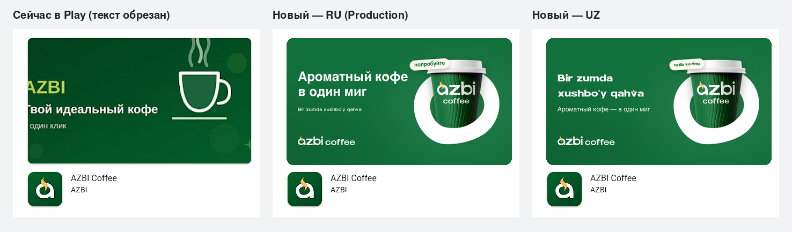

# Google Play — Feature Graphic

Баннер витрины Google Play для AZBI Coffee.

| Файл | Размер | Для чего |
| --- | --- | --- |
| `feature-graphic_ru_1024x500.png` | 1024×500, 24-bit PNG без альфа-канала | **Production**, основной листинг (ru) |
| `feature-graphic_uz_1024x500.png` | 1024×500, 24-bit PNG без альфа-канала | Узбекская локализация листинга / другие каналы |

Загрузка: Play Console → Основной листинг → Графика → Feature graphic.



## Основа — брендбук AZBI

- **Брендбук** (605 agency, 2024) по ссылке из паспорта проекта: `Azbi brandbook.pdf`.
- **Композиция** повторяет страницу «Reklama banneri» (с. 37): заголовок слева, горизонтальный логотип
  `azbi coffee` внизу слева, стакан в фирменном элементе справа, светлая плашка-стикер у крышки.
- **Фирменный элемент** «Brend tanituvchi elementi» (с. 20): стакан «ныряет» в органическое кольцо —
  верхняя половина кольца за стаканом, нижняя перед ним; пропорции взяты со страницы брендбука.
- **Слоган** (с. 9, «Shior»), пишется на двух языках: `Bir zumda xushbo‘y qahva` / `Ароматный кофе — в один миг`.
  Плашка — `tatib ko‘ring` с билборда, в RU-версии перевод: «попробуйте».
- **Цвета** (с. 15): Azbi green `#11703B`, светло-жёлтый `#FCB95C` (пар), кремовый `#FFFBED`.
- **Шрифты** (с. 18–19): Galdern — латинские заголовки; Helvetica Neue Cyr — русский текст.
  Жирной кириллицы Helvetica Neue Cyr в PDF нет, поэтому русский заголовок набран Nimbus Sans Bold
  (метрический клон Helvetica от URW).
- **Пар над буквой** — приём «Shakl bilan yozish» из брендбука, как в `qahva` и `americano`.
- Логотип, кольцо и пар — векторы из PDF; фото стакана — из брендбука (с. 46).

## Safe zone

Витрина Play показывает баннер в карточке с пропорциями ~1.77:1 и скруглёнными углами: примерно
**68 px с каждой стороны** (в масштабе 1024) уходят в обрезку. Отсюда и проблема текущего баннера.

- Текст и логотип начинаются от **x = 112 px**, всё содержимое заканчивается до **x ≈ 906 px**.
- По вертикали содержимое лежит в пределах y ≈ 80–422 px.
- `previews/*_guides.png`: красным — обрезка Play, пунктиром — safe zone 96/56 px.

## Пересборка

```bash
sudo apt-get install -y fonts-urw-base35   # Nimbus Sans; нужен также Google Chrome/Chromium
pip install -r requirements.txt
python3 scripts/build.py --guides
```

Скрипт скачивает брендбук с публичной ссылки Яндекс.Диска, достаёт из него шрифты в `src/.fonts/`
(в git не попадают: шрифты лицензированы на AZBI), рендерит `src/feature-graphic.html?v=ru|uz`
в headless Chrome на 2× и уменьшает до 1024×500. Вёрстка редактируется в `src/feature-graphic.html`,
а `?guides=1` показывает оверлей safe zone прямо в браузере.

`previews/play-store-before-after.png` собран один раз по скриншоту текущей витрины и скриптом не пересобирается.
